# VHL Text Overlay

*[Leer en español ↓](#español)*

**Write on your VHL textbook pages, like writing on sticky notes over the page.**

When you have your textbook open on **reader.vhlcentral.com**, this tool lets you
click anywhere on the page and type. You can use it to fill in blanks, add notes, or
show answers. When you're finished, you can copy a picture of the page with your
writing on it and paste it anywhere.

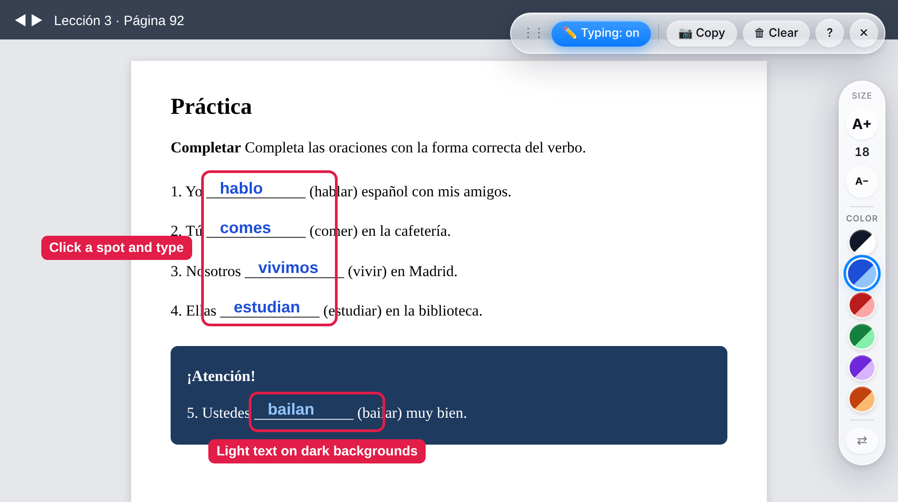

Your writing is **not saved** and doesn't change the real textbook. It sits on top of the
page, like a clear sheet of plastic, and disappears when you close or refresh the page.
To keep your work, copy a picture of it (see step 6 below).

It works in the **Google Chrome** web browser on a computer. It does not work on phones
or tablets.

---

## Part 1: Install it (you only do this once)

This takes about 3 minutes.

### Step 1: Download it

1. Click this link: **[Download VHL Text Overlay](https://github.com/aidanmccants/vhl-overlay/releases/latest/download/VHL-Text-Overlay.zip)**.
   A file called **VHL-Text-Overlay.zip** goes into your **Downloads** folder.
   - You can also find it on the **[Releases page](https://github.com/aidanmccants/vhl-overlay/releases/latest)**.
     Scroll down to **Assets** and click **VHL-Text-Overlay.zip**.
2. Open your **Downloads** folder and double-click **VHL-Text-Overlay.zip**.
   - **On a Mac:** a folder called **VHL Text Overlay** appears next to it.
   - **On Windows:** click **Extract all** at the top of the window, then click **Extract**.
     A new window opens with a folder called **VHL Text Overlay** inside it.
3. **Don't delete the VHL Text Overlay folder**, or the tool stops working. You may want
   to move it somewhere safe, like your **Documents** folder.

### Step 2: Add it to Chrome

1. Open Google Chrome.
2. Click the address bar at the top (where you normally type a website), type
   `chrome://extensions` and press **Enter**.
3. In the top-right corner, turn on the switch labeled **Developer mode**.
   (The name sounds technical, but turning it on just lets you add tools that aren't from
   Chrome's online store.)

   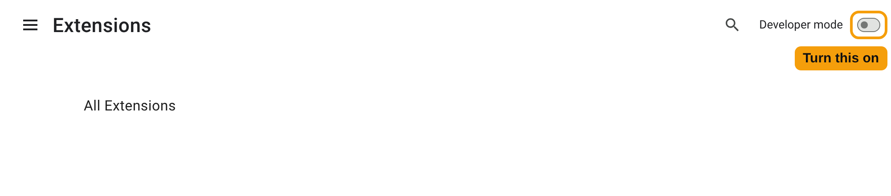

4. Click the **Load unpacked** button that appears on the left.

   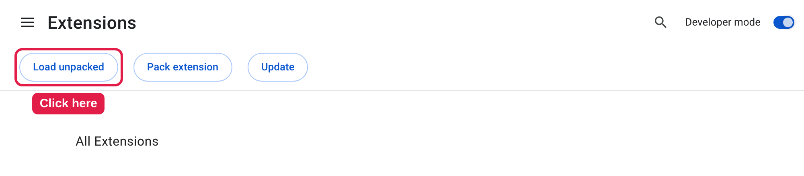

5. A window opens so you can choose a folder. Find the **VHL Text Overlay** folder from
   Step 1, click it **once**, and click **Select** (or **Open**).
6. A box named **VHL Text Overlay** now appears on the page. That means it's installed.

   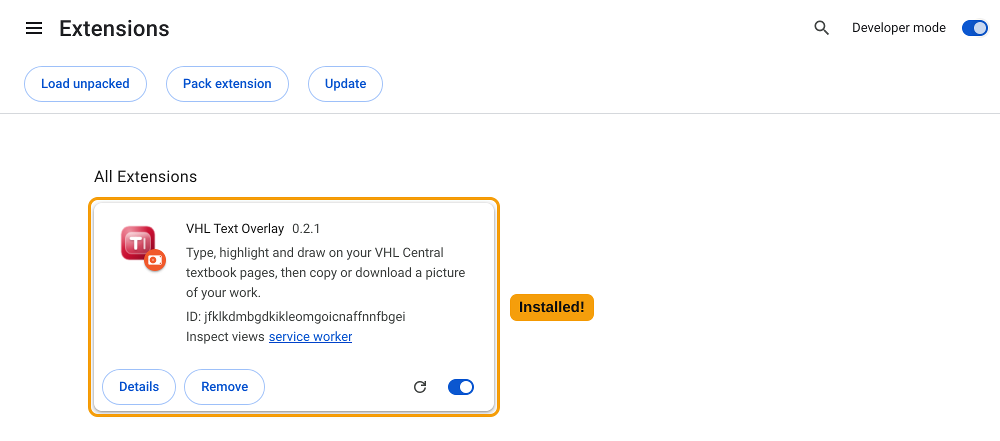

7. A **welcome page** also opens in a new tab with a short summary of the next steps.

   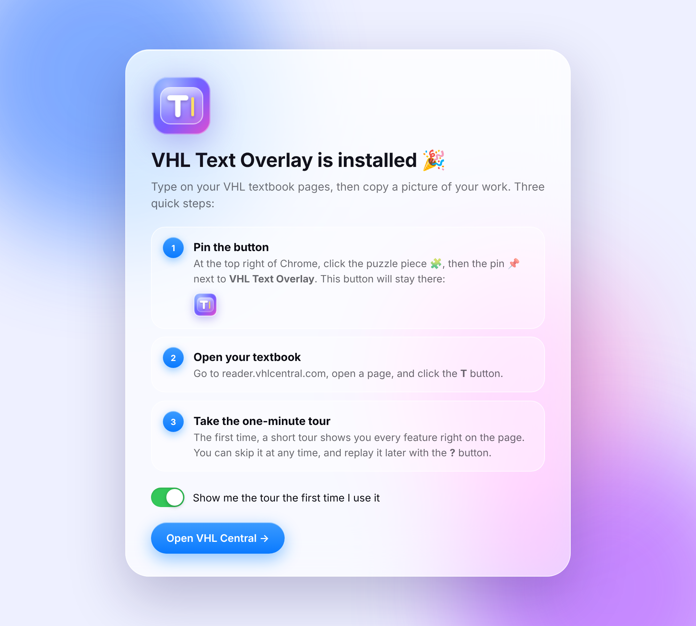

   The switch at the bottom controls the **one-minute tour** (see Part 2). Leave it on to
   get the tour, or turn it off to skip it.

### Step 3: Put the button where you can see it

1. At the top right of Chrome, next to the address bar, click the small **puzzle-piece**
   icon 🧩.
2. Find **VHL Text Overlay** in the list and click the **pin** 📌 next to it.
3. This button now stays at the top right of Chrome:
    That's your button.

---

## Part 2: Use it

### 1. Open your textbook

Go to reader.vhlcentral.com and open the page you want, the same way you normally would.

### 2. Turn it on

Click the **T** button at the top right of Chrome. Two small toolbars appear: a bar
of buttons at the top right of the page, and a narrow toolbar for **text size and color**
on the right edge. You're now ready to write.

**The first time**, a short tour starts and shows you every feature, one at a time, right
on the page. A glowing ring points at each button, and you can try things as you go.
Click **Next** to move on, **Back** to go back, or **Skip tour** to close it at any time.
To see it again later, click the **?** button on the top bar.

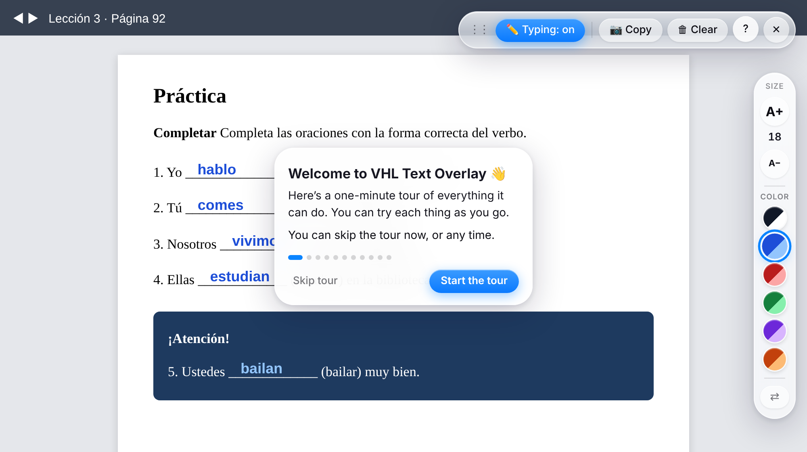

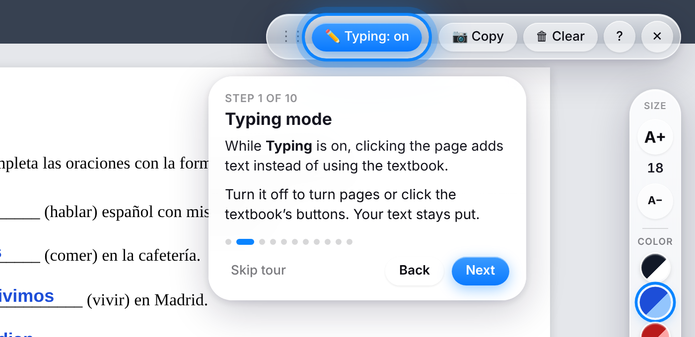

### 3. Write on the page

- **Click** anywhere on the page, for example on a blank line, and **type**.
- To write somewhere else, just **click** in the new spot and type.
- Press **Enter** to start a new line in the same spot.
- Press **Esc** (top-left key on your keyboard) when you're done with a piece of writing.
- **To fix something:** click your writing and type or delete.
- **To move it:** click your writing, then drag the small blue **✥** tab just above it.
- **To erase it:** click your writing, then click the small red **×** above it.

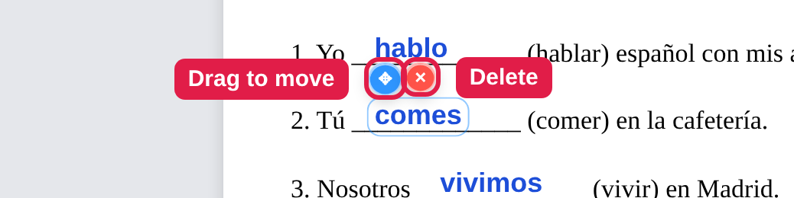

Your writing stays in place on the page, even if you scroll up and down or zoom in.

**Your writing is always easy to read.** When you start writing somewhere, the tool checks
the colors behind that spot and picks a shade that stands out. On a dark box, blue
becomes light blue (like *bailan* in the picture above). On a photo or a busy picture,
your writing gets a thin outline so you can still read it.

### 4. The bar at the top

| | Button | What it does |
|---|---|---|
| **1** | **✏️ Typing: on / off** | While it's **on**, clicking the page adds writing. Turn it **off** to use the textbook normally (turn pages, click buttons). Your writing stays on the page. |
| **2** | **📷 Copy** | Copies a picture of the page with your writing (see below). |
| **3** | **🗑 Clear** | Erases all of your writing on the page. |
| **4** | **?** | Shows the tour of every feature again. |
| **5** | **✕** | Hides both toolbars. Your writing stays. Click the **T** button to bring them back. |

You can move the top bar by dragging the dots **⋮⋮** at its left end.

### 5. Text size and color (the toolbar on the side)

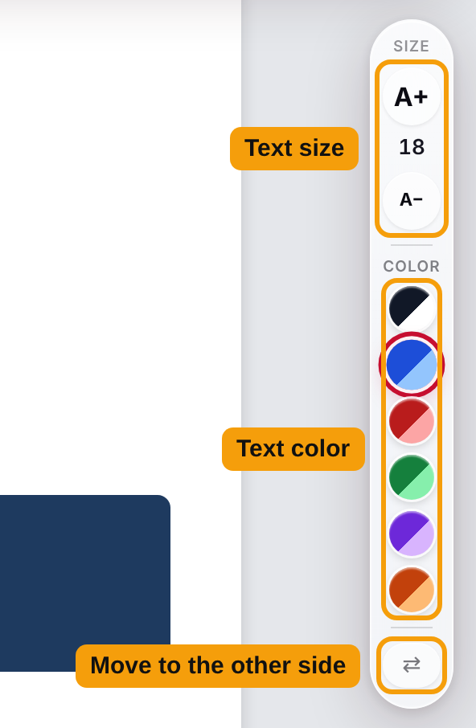

- **A+** makes the writing bigger and **A−** makes it smaller. The number shows the size.
- The **colored dots** pick the color of your writing. Each dot shows two shades: the
  darker one is used on light backgrounds and the lighter one on dark backgrounds.
  The black dot turns white on dark backgrounds.
- **⇄** moves this toolbar to the other side of the screen if it's in your way.

> **Tip:** To change the size or color of something you already wrote, click it first,
> then click **A+**, **A−**, or a color.

### 6. Keep your work: copy a picture

1. Click **📷 Copy** (or press **Alt + Shift + S**).
2. Chrome asks if you want to **share this tab**. Click **Share** (or **Allow**).
   Nothing is recorded or sent anywhere: the tool takes one picture and stops sharing
   right away.
3. This message appears at the bottom of the page:

   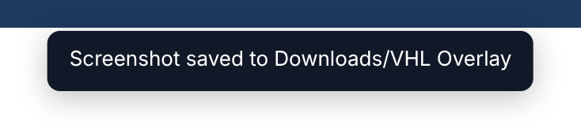

4. **Paste** the picture wherever you want it, for example an email, a Google Doc, Word,
   or an assignment: press **Ctrl + V** (on a Mac, **⌘ Command + V**).

The toolbars and the small blue and red tabs are left out of the picture. The picture only
includes what you can see on the screen, so scroll first to show the part you want.

> **Tip:** The picture is only on your clipboard until you copy something else, so paste
> it right away.

---

## If something doesn't work

**Chrome says "Manifest file is missing or unreadable."**
You chose the wrong folder in Step 2. Click **Load unpacked** again and pick the folder
named **VHL Text Overlay**. It has a folder named **icons** inside it.

**I clicked 📷 Copy but nothing happened, or it says "Screenshot cancelled."**
When Chrome asks to share this tab, click **Share** (or **Allow**), not **Cancel**.

**It says "Screenshot ready" with a "Copy to clipboard" button.**
Click that button. (This happens if you clicked somewhere else while Chrome was asking.)

**Nothing appears when I paste.**
Make sure you saw the "Screenshot copied" message, then paste with **Ctrl + V**
(**⌘ Command + V** on a Mac) right away, before copying anything else.

**I can't click the textbook's buttons or turn the page.**
Typing is on, so your clicks add writing instead. Click **✏️ Typing: on** to turn it
off. Click it again when you want to write.

**My writing disappeared.**
Refreshing the page or closing the tab erases your writing. Sometimes turning to a new
page also hides the writing from the old page. Remember to click **📷 Copy** and paste your picture before you
move on.

**The T button does nothing.**
Make sure you're on reader.vhlcentral.com. The tool only works on that website.

**Chrome shows a message about "developer mode extensions."**
This is normal for tools added this way. You can close the message.

**Keyboard shortcuts (optional)**
- **Alt + Shift + T**: turn the tool on or off (same as the **T** button)
- **Alt + Shift + S**: copy a picture (same as **📷 Copy**)

On a Mac, **Alt** is the **Option** key.

### Getting a newer version

When a new version comes out, download it again (Step 1) and put the new **VHL Text
Overlay** folder in place of the old one. Then go to `chrome://extensions` and click the
round arrow ↻ on the **VHL Text Overlay** box.

---
---

# VHL Text Overlay (en español)

**Escriba sobre las páginas de su libro de VHL, como si pegara notas encima de la página.**

Con el libro abierto en **reader.vhlcentral.com**, esta herramienta le permite hacer clic
en cualquier parte de la página y escribir. Sirve para completar espacios en blanco,
añadir notas o mostrar respuestas. Al terminar, puede copiar una imagen de la página
con lo que escribió y pegarla donde quiera.

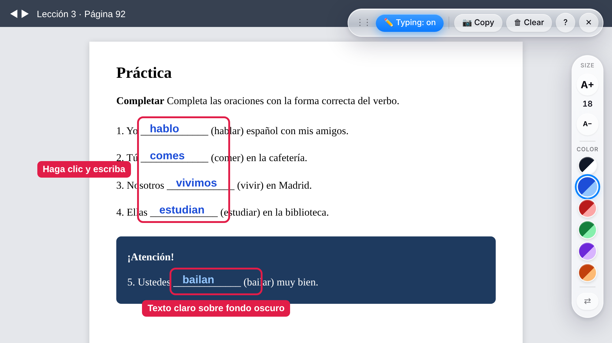

Lo que escribe **no se guarda** y no cambia el libro de verdad. Queda encima de la
página, como una hoja de plástico transparente, y desaparece al cerrar o recargar la
página. Para conservar su trabajo, copie una imagen (vea el paso 6).

Funciona en el navegador **Google Chrome** en un ordenador. No funciona en móviles ni
tabletas.

---

## Parte 1: Instalación (solo una vez)

Tarda unos 3 minutos.

### Paso 1: Descargarla

1. Haga clic en este enlace: **[Descargar VHL Text Overlay](https://github.com/aidanmccants/vhl-overlay/releases/latest/download/VHL-Text-Overlay.zip)**.
   Se descargará a su carpeta **Descargas** un archivo llamado **VHL-Text-Overlay.zip**.
   - También está en la **[página de versiones (Releases)](https://github.com/aidanmccants/vhl-overlay/releases/latest)**.
     Baje hasta **Assets** y haga clic en **VHL-Text-Overlay.zip**.
2. Abra la carpeta **Descargas** y haga doble clic en **VHL-Text-Overlay.zip**.
   - **En un Mac:** aparecerá al lado una carpeta llamada **VHL Text Overlay**.
   - **En Windows:** haga clic en **Extraer todo** en la parte de arriba de la ventana y
     luego en **Extraer**. Se abrirá una ventana con una carpeta llamada
     **VHL Text Overlay** dentro.
3. **No borre la carpeta VHL Text Overlay**, porque si no la herramienta deja de
   funcionar. Puede moverla a un lugar seguro, como **Documentos**.

### Paso 2: Añadirla a Chrome

1. Abra Google Chrome.
2. Haga clic en la barra de direcciones (donde normalmente escribe una página web),
   escriba `chrome://extensions` y pulse **Intro**.
3. Arriba a la derecha, active el interruptor **Modo Desarrollador**. (El nombre suena
   técnico, pero solo permite añadir herramientas que no vienen de la tienda de Chrome.)

   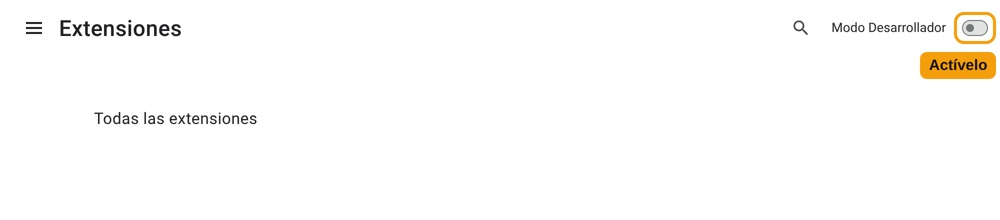

4. Haga clic en el botón **Cargar descomprimida** que aparece a la izquierda.

   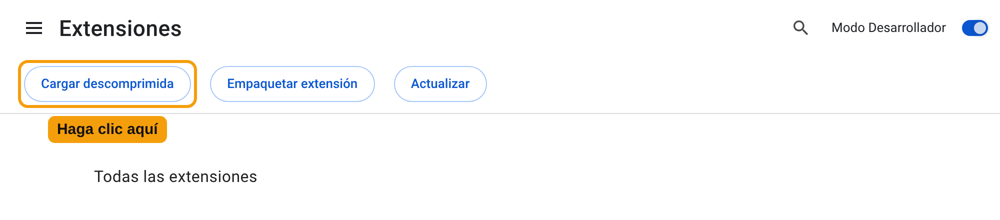

5. Se abre una ventana para elegir una carpeta. Busque la carpeta **VHL Text Overlay** del
   Paso 1, haga **un solo clic** en ella y luego en **Seleccionar** (o **Abrir**).
6. Ahora aparece un recuadro llamado **VHL Text Overlay**. Eso significa que está instalada.

   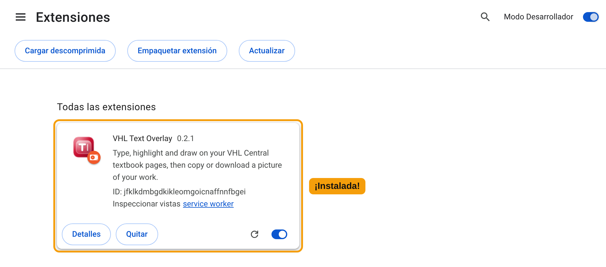

7. También se abre una **página de bienvenida** en una pestaña nueva con un resumen de los
   siguientes pasos.

   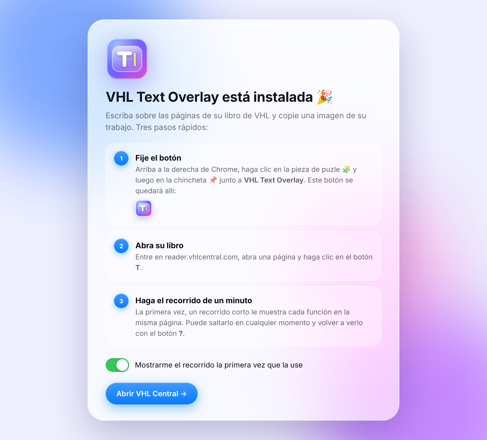

   El interruptor de abajo controla el **recorrido de un minuto** (vea la Parte 2). Déjelo
   activado para ver el recorrido, o desactívelo para saltarlo.

### Paso 3: Poner el botón a la vista

1. Arriba a la derecha de Chrome, junto a la barra de direcciones, haga clic en el icono
   de la **pieza de puzle** 🧩.
2. Busque **VHL Text Overlay** y haga clic en la **chincheta** 📌 que tiene al lado.
3. Este botón queda ahora arriba a la derecha de Chrome:
    Ese es su botón.

---

## Parte 2: Uso

### 1. Abra el libro

Entre en reader.vhlcentral.com y abra la página que quiera, como siempre.

### 2. Actívela

Haga clic en el botón **T**, arriba a la derecha de Chrome. Aparecen dos pequeñas
barras: una barra de botones arriba a la derecha de la página y una barra estrecha para
el **tamaño y el color del texto** en el borde derecho. Ya puede escribir.

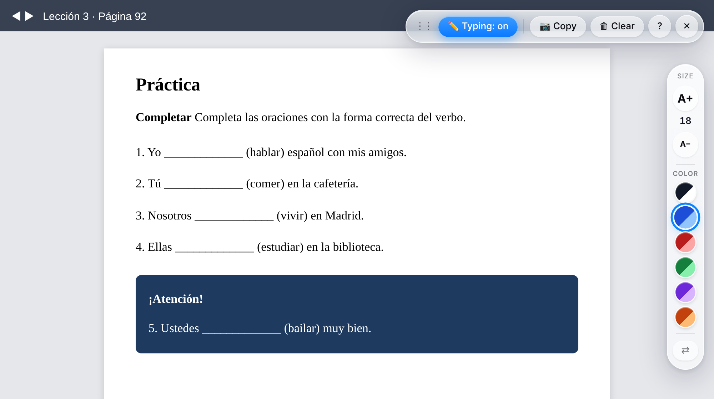

**La primera vez**, empieza un recorrido corto que le muestra cada función, una por una,
en la misma página. Un anillo luminoso señala cada botón y puede ir probando las cosas.
Pulse **Siguiente** para avanzar, **Atrás** para volver o **Saltar** para cerrarlo en
cualquier momento. Para verlo otra vez, pulse el botón **?** de la barra de arriba. (El
recorrido aparece en español si Chrome está en español.)

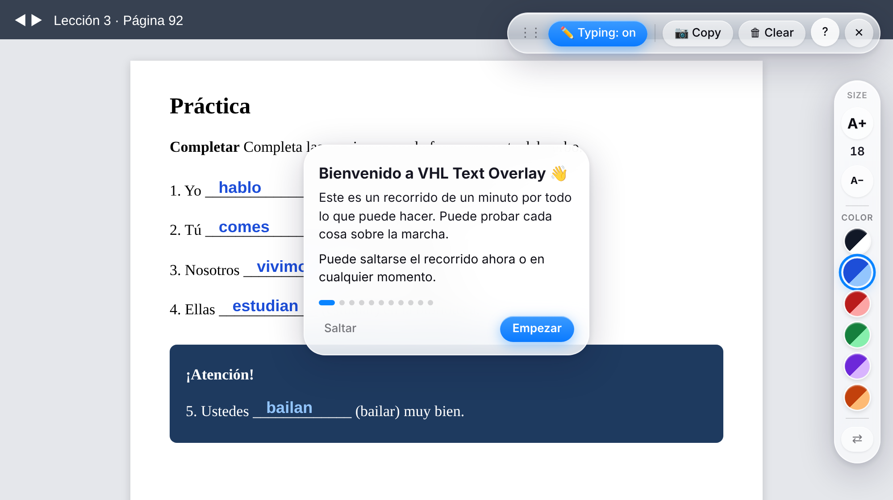

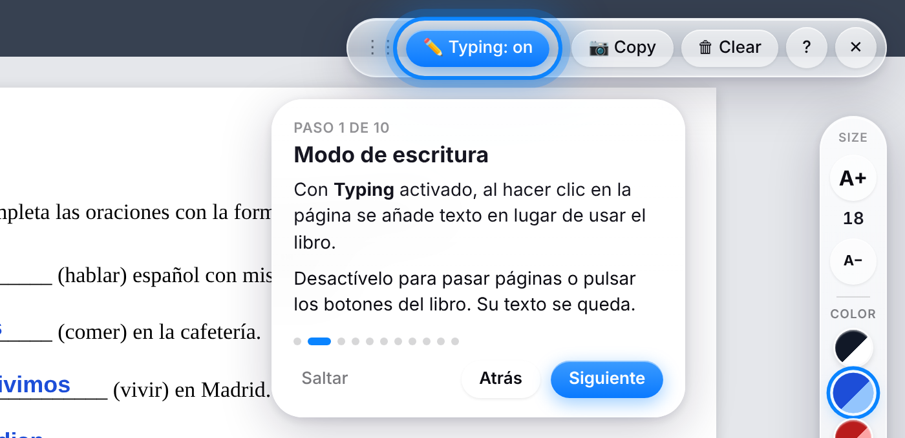

### 3. Escriba sobre la página

- **Haga clic** en cualquier parte de la página, por ejemplo en un espacio en blanco, y
  **escriba**.
- Para escribir en otro sitio, **haga clic** en el nuevo lugar y escriba.
- Pulse **Intro** para empezar una línea nueva en el mismo sitio.
- Pulse **Esc** (tecla de arriba a la izquierda) al terminar un texto.
- **Para corregir:** haga clic en su texto y escriba o borre.
- **Para moverlo:** haga clic en su texto y arrastre la pequeña pestaña azul **✥** que
  aparece encima.
- **Para borrarlo:** haga clic en su texto y luego en la pequeña **×** roja de encima.

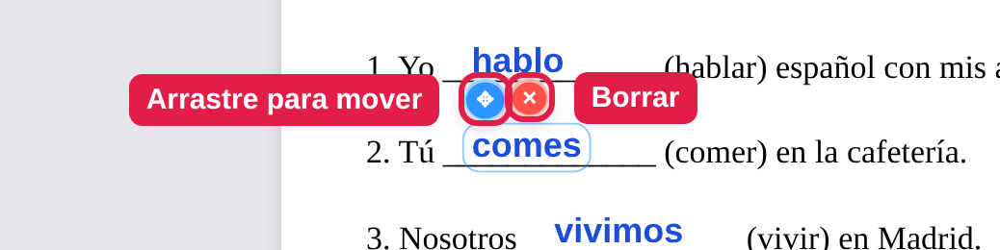

El texto se queda en su sitio en la página, aunque se desplace hacia arriba o abajo o
amplíe la página.

**Lo que escribe siempre se lee bien.** Al empezar a escribir en un lugar, la herramienta
mira los colores del fondo y elige un tono que destaque. Sobre un recuadro oscuro, el azul
pasa a azul claro (como *bailan* en la imagen de arriba). Sobre una foto o un dibujo con
muchos colores, el texto lleva un contorno fino para que se pueda leer.

### 4. La barra de arriba

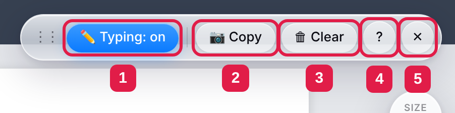

| | Botón | Qué hace |
|---|---|---|
| **1** | **✏️ Typing: on / off** | Cuando está en **on** (activado), al hacer clic en la página se añade texto. Póngalo en **off** (desactivado) para usar el libro con normalidad (pasar páginas, pulsar botones). Su texto sigue en la página. |
| **2** | **📷 Copy** | Copia una imagen de la página con su texto (vea abajo). |
| **3** | **🗑 Clear** | Borra todo lo que escribió en la página. |
| **4** | **?** | Vuelve a mostrar el recorrido de todas las funciones. |
| **5** | **✕** | Oculta las dos barras. Su texto se queda. Haga clic en el botón **T** para que vuelvan. |

Puede mover la barra de arriba arrastrando los puntos **⋮⋮** de su lado izquierdo.

### 5. Tamaño y color del texto (la barra del lateral)

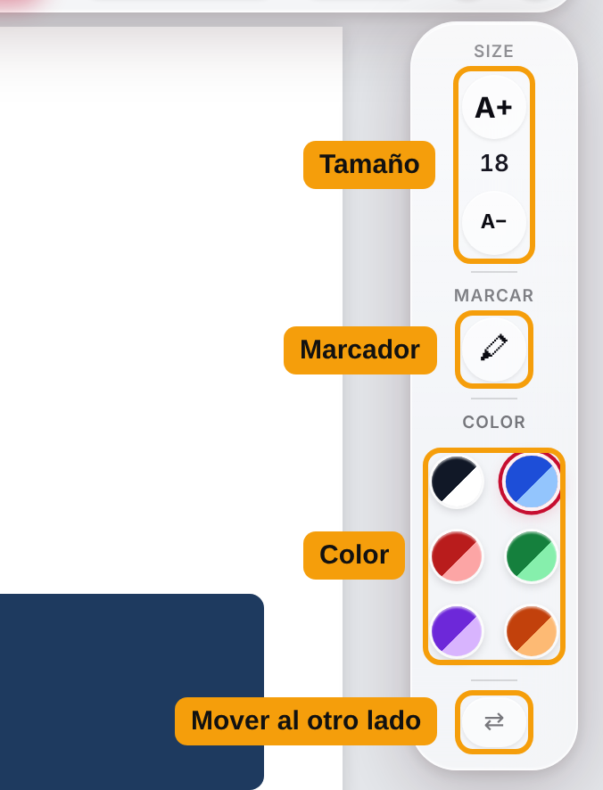

- **A+** agranda el texto y **A−** lo hace más pequeño. El número indica el tamaño.
- Los **puntos de colores** eligen el color del texto. Cada punto muestra dos tonos: el más
  oscuro se usa sobre fondos claros y el más claro sobre fondos oscuros. El punto negro
  se vuelve blanco sobre fondos oscuros.
- **⇄** mueve esta barra al otro lado de la pantalla si le molesta.

> **Consejo:** para cambiar el tamaño o el color de algo que ya escribió, haga clic en
> ello primero y luego en **A+**, **A−** o un color.

### 6. Conserve su trabajo: copie una imagen

1. Haga clic en **📷 Copy** (o pulse **Alt + Mayús + S**).
2. Chrome pregunta si quiere **compartir esta pestaña**. Haga clic en **Compartir** (o
   **Permitir**). No se graba ni se envía nada: la herramienta toma una sola imagen y deja
   de compartir enseguida.
3. Aparece este mensaje abajo en la página ("Captura copiada. Péguela donde quiera con
   Ctrl+V"):

   

4. **Pegue** la imagen donde la quiera, por ejemplo en un correo, un documento de Google,
   Word o una tarea: pulse **Ctrl + V** (en un Mac, **⌘ Comando + V**).

Las barras de botones y las pestañas azules y rojas no salen en la imagen. La imagen solo
incluye lo que se ve en la pantalla, así que desplácese primero hasta la parte que quiera.

> **Consejo:** la imagen solo se queda en el portapapeles hasta que copie otra cosa, así
> que péguela enseguida.

---

## Si algo no funciona

**Chrome dice que falta el archivo de manifiesto ("Manifest file is missing").**
Eligió una carpeta equivocada en el Paso 2. Pulse otra vez **Cargar descomprimida** y
elija la carpeta llamada **VHL Text Overlay**. Dentro tiene una carpeta llamada **icons**.

**Pulsé 📷 Copy y no pasó nada, o sale "Screenshot cancelled" (captura cancelada).**
Cuando Chrome pregunte si quiere compartir esta pestaña, pulse **Compartir** (o
**Permitir**), no **Cancelar**.

**Sale "Screenshot ready" (captura lista) con un botón "Copy to clipboard".**
Pulse ese botón. (Pasa si hizo clic en otro sitio mientras Chrome preguntaba.)

**Al pegar no aparece nada.**
Compruebe que vio el mensaje "Screenshot copied" y pegue con **Ctrl + V** (**⌘ Comando + V**
en un Mac) enseguida, antes de copiar otra cosa.

**No puedo pulsar los botones del libro ni pasar de página.**
La escritura está activada, así que sus clics añaden texto. Pulse **✏️ Typing: on** para
desactivarla. Púlselo otra vez cuando quiera escribir.

**Mi texto ha desaparecido.**
Recargar la página o cerrar la pestaña borra lo que escribió. A veces, al pasar de
página también se oculta el texto de la página anterior. Recuerde pulsar **📷 Copy** y pegar la imagen
antes de seguir.

**El botón T no hace nada.**
Compruebe que está en reader.vhlcentral.com. La herramienta solo funciona en esa web.

**Chrome muestra un aviso sobre extensiones en "modo de desarrollador".**
Es normal con las herramientas añadidas de esta forma. Puede cerrar el aviso.

**Atajos de teclado (opcional)**
- **Alt + Mayús + T**: activar o desactivar la herramienta (igual que el botón **T**)
- **Alt + Mayús + S**: copiar una imagen (igual que **📷 Copy**)

En un Mac, **Alt** es la tecla **Opción**.

### Obtener una versión nueva

Cuando salga una versión nueva, descárguela otra vez (Paso 1) y ponga la nueva carpeta
**VHL Text Overlay** en lugar de la anterior. Luego vaya a `chrome://extensions` y haga
clic en la flecha circular ↻ del recuadro **VHL Text Overlay**.

---

## For the maintainer: publishing a release

The download link above always points to the newest release. To publish one:

1. Raise `"version"` in `extension/manifest.json` (for example `0.1.0` → `0.1.1`).
2. On GitHub, open **Actions** → **Publish release** → **Run workflow**.

This builds `VHL-Text-Overlay.zip` and publishes it as release `v<version>`. Pushing a
tag like `v0.1.1` does the same. Screenshots in `docs/images/` were taken in Chrome
(English and Spanish) against a sample page.
