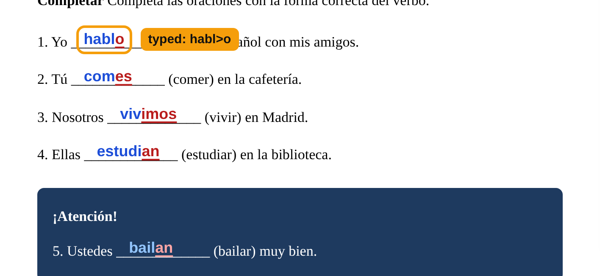
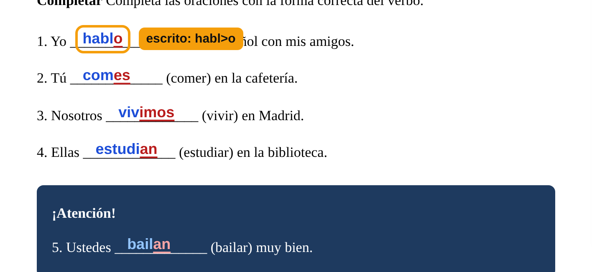
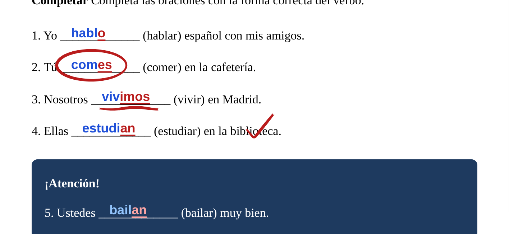

# VHL Text Overlay

*[Leer en español ↓](#español)*

**Write on your VHL textbook pages, like writing on sticky notes over the page.**

When you have your textbook open on **reader.vhlcentral.com**, this tool lets you
click anywhere on the page and type. You can use it to fill in blanks, add notes, or
show answers. When you're finished, you can take a picture of the page with your
writing on it, then copy it or download it.

Your writing is **not saved** and doesn't change the real textbook. It sits on top of the
page, like a clear sheet of plastic, and disappears when you close or refresh the page.
To keep your work, take a picture of it (see step 6 below).

It works in the **Google Chrome** web browser on a computer. It does not work on phones
or tablets.

---

## Part 1: Install it (you only do this once)

This takes about 3 minutes.

### Step 1: Download it

1. Click this link: **[Download VHL Text Overlay](https://github.com/aidanmccants/vhl-overlay/releases/latest/download/VHL-Text-Overlay.zip)**.
   A file called **VHL-Text-Overlay.zip** goes into your **Downloads** folder.
   - You can also find it on the **[Releases page](https://github.com/aidanmccants/vhl-overlay/releases/latest)**.
     Scroll down to **Assets** and click **VHL-Text-Overlay.zip**.
2. Open your **Downloads** folder and unzip **VHL-Text-Overlay.zip**:
   - **On a Mac:** double-click it. A folder called **VHL-Text-Overlay** appears next to it.
   - **On Windows:** right-click it, choose **Extract All…**, then click **Extract**. A folder
     called **VHL-Text-Overlay** is created next to it, and Windows opens it to show the
     files inside (`manifest.json`, `content.js`, an **icons** folder and a few more).
3. **Don't delete the VHL-Text-Overlay folder**, or the tool stops working. You may want
   to move it somewhere safe, like your **Documents** folder.

### Step 2: Add it to Chrome

1. Open Google Chrome.
2. Click the address bar at the top (where you normally type a website), type
   `chrome://extensions` and press **Enter**.
3. In the top-right corner, turn on the switch labeled **Developer mode**.
   (The name sounds technical, but turning it on just lets you add tools that aren't from
   Chrome's online store.)

   

4. Click the **Load unpacked** button that appears on the left.

   

5. A window opens so you can choose a folder. Find the **VHL-Text-Overlay** folder from
   Step 1, click it **once**, and click **Select Folder** (on a Mac, **Select**). Choose
   the folder itself, not a file inside it.

   > **Only see an "icons" folder?** That's normal. This window only shows folders, so
   > the files inside are hidden here, but they're still there. If you've opened
   > **VHL-Text-Overlay** and see just **icons**, you're in the right place: click
   > **Select Folder**. Don't open **icons**.
6. A box named **VHL Text Overlay** now appears on the page. That means it's installed.

   

7. A **welcome page** also opens in a new tab with a short summary of the next steps.

   

   The switch at the bottom controls the **one-minute tour** (see Part 2). Leave it on to
   get the tour, or turn it off to skip it.

### Step 3: Put the button where you can see it

1. At the top right of Chrome, next to the address bar, click the small **puzzle-piece**
   icon 🧩.
2. Find **VHL Text Overlay** in the list and click the **pin** 📌 next to it.
3. This button now stays at the top right of Chrome:
    That's your button.

---

## Part 2: Use it

### 1. Open your textbook

Go to reader.vhlcentral.com and open the page you want, the same way you normally would.

### 2. Turn it on

Click the **T** button at the top right of Chrome. Two small toolbars appear: a bar
of buttons at the top right of the page, and a narrow toolbar for **text size and color**
on the right edge. You're now ready to write.

**The first time**, a short tour starts and shows you every feature, one at a time, right
on the page. A glowing ring points at each button, and you can try things as you go.
Click **Next** to move on, **Back** to go back, or **Skip tour** to close it at any time.
To see it again later, click the **?** button on the top bar.

### 3. Write on the page

- **Click** anywhere on the page, for example on a blank line, and **type**.
- To write somewhere else, just **click** in the new spot and type.
- Press **Enter** to start a new line in the same spot.
- Press **Esc** (top-left key on your keyboard) when you're done with a piece of writing.
- **To fix something:** click your writing and type or delete.
- **To move it:** click your writing, then drag the small dark gray **move** tab (four arrows) just above it.
- **To erase it:** click your writing, then click the small red **X** above it.

Your writing stays in place on the page, even if you scroll up and down or zoom in.

**Your writing is always easy to read.** When you start writing somewhere, the tool checks
the colors behind that spot and picks a shade that stands out. On a dark box, blue
becomes light blue (like *bailan* in the picture above). On a photo or a busy picture,
your writing gets a thin outline so you can still read it.

### 4. The bar at the top

| | Button | What it does |
|---|---|---|
| **1** | **Off · Pen · Typing** | Chooses what clicking the page does. **Typing**: clicking adds writing. **Pen**: you draw (see below). **Off**: use the textbook normally (turn pages, click buttons). Your work stays on the page in every mode. |
| **2** | **Screenshot** | Takes a picture of the page with your writing, to copy or download (see below). |
| **3** | **Clear** | Erases all of your writing and drawings on the page. |
| **4** | **?** | Shows the tour of every feature again. |
| **5** | **X** | Hides both toolbars. Your writing stays. Click the **T** button to bring them back. |

You can move the top bar by dragging the six dots at its left end.

### 5. Text size and color (the toolbar on the side)

- **A+** makes the writing bigger and **A−** makes it smaller. The number shows the size.
- The **colored dots** pick the color of your writing. Each dot shows two shades: the
  darker one is used on light backgrounds and the lighter one on dark backgrounds.
  The black dot turns white on dark backgrounds.
- The **highlighter** (marker icon) marks letters, and the **eraser** erases drawings (see below).
- The **two arrows** button at the bottom moves this toolbar to the other side of the screen if it's in your way.

> **Tip:** To change the size or color of something you already wrote, click it first,
> then click **A+**, **A−**, or a color.

### Highlight part of a word (for example a verb ending)

You can show some letters in a different color, like the ending in **habl<u>o</u>** or
**limpi<u>e</u>**. Marked letters are also **bold and underlined**, so they still stand
out in a black-and-white printout.

There are three ways to do it. Use whichever you like:

- **Type `>` while you write.** Type `>` right before the letters you want marked:
  typing `hac>er` gives hac**er** with "er" marked. The mark ends when you type a space,
  so you can keep writing normally. (To type a real `>`, press it twice: `>>`.)
- **Select and click a color, like in Word.** In something you already wrote, select the
  letters (drag across them, or hold **Shift** and press the arrow keys), then click a color
  dot. Only those letters change. Click the box's own color to take the mark off.
- **Use the highlighter.** Click the **highlighter** button on the side toolbar, then click a
  letter to mark it, or drag across several letters. Click a marked letter again to unmark
  it. While the highlighter is on, the color dots choose the marker color (red at first).
  Click the **highlighter** button again (or **Typing**) to go back
  to typing.

  **Shortcut:** select letters first, then click the **highlighter** button. Just those
  letters get marked in the marker color, and you can keep typing. Do it again to unmark them.

### Draw with a pen (or a mouse, or your finger)

Click **Pen** on the top bar, then draw on the page: circle an answer, underline a
word, cross out a mistake. It works with a pen like a **Surface Pen**, a mouse, or a finger
on a touch screen.

- **Press harder for a thicker line** (with a pen).
- **To erase,** flip a Surface Pen over and rub with its eraser end, or click the **eraser** on the
  side toolbar and touch the lines you want to erase. Each touch erases a whole line.
- **Ctrl + Z** undoes the last line (or erase), and **Ctrl + Shift + Z** brings it back.
- The **color dots** and **A+ / A−** set the color and thickness for new lines. Lines stay
  readable on dark boxes, like your writing.
- Drawings stay in place on the page when you scroll or zoom, and they're in your
  screenshots.
- The mouse wheel still scrolls the page. Once you've used a pen, a finger on the screen
  scrolls instead of drawing, so your hand resting on the screen doesn't leave marks.

Click **Off** when you want to use the textbook again, or **Typing** to write.

### 6. Keep your work: take a picture

1. Click **Screenshot** (or press **Alt + Shift + S**).
2. Chrome asks if you want to **share this tab**. Click **Share** (or **Allow**).
   Nothing is recorded or sent anywhere: the tool takes one picture and stops sharing
   right away.
3. A small card appears at the bottom of the page with a preview of your picture:

   

4. Choose what to do with it. You can do both:
   - **Copy**: then **paste** the picture wherever you want it, for example an email, a
     Google Doc, Word, or an assignment. Press **Ctrl + V** (on a Mac, **⌘ Command + V**).
     The picture is only on your clipboard until you copy something else, so paste it
     right away.
   - **Download**: saves the picture as a file in your **Downloads** folder. It's named
     with the date and time, for example `vhl-2026-11-13_14-55-02.png`.

   Click **X** to close the card.

The toolbars and the small gray and red tabs are left out of the picture. The picture only
includes what you can see on the screen, so scroll first to show the part you want.

---

## If something doesn't work

**Chrome says "Manifest file is missing or unreadable."**
You chose the wrong folder in Step 2. Click **Load unpacked** again and pick the folder
that has **manifest.json** directly inside it. That's the **VHL-Text-Overlay** folder from
Step 1. (If you downloaded an older version, the right folder may be one level deeper,
named **VHL Text Overlay**.)

**I clicked Screenshot but nothing happened, or it says "Screenshot cancelled."**
When Chrome asks to share this tab, click **Share** (or **Allow**), not **Cancel**.

**It says "Couldn't copy."**
Click **Copy** again. If it still doesn't work, click **Download** instead.

**Nothing appears when I paste.**
Make sure the **Copy** button turned green and says **Copied**, then paste with
**Ctrl + V** (**⌘ Command + V** on a Mac) right away, before copying anything else.

**I can't click the textbook's buttons or turn the page.**
Typing or Pen is on, so your clicks add writing or drawing instead. Click **Off** on the
top bar. Click **Typing** or **Pen** again when you want to write or draw.

**My writing disappeared.**
Refreshing the page or closing the tab erases your writing. Sometimes turning to a new
page also hides the writing from the old page. Remember to take a picture with **Screenshot** before you
move on.

**The T button does nothing.**
Make sure you're on reader.vhlcentral.com. The tool only works on that website.

**Chrome shows a message about "developer mode extensions."**
This is normal for tools added this way. You can close the message.

**Keyboard shortcuts (optional)**
- **Alt + Shift + T**: turn the tool on or off (same as the **T** button)
- **Alt + Shift + S**: take a picture (same as **Screenshot**)

On a Mac, **Alt** is the **Option** key.

### Getting a newer version

When a new version comes out, download it again (Step 1) and put the new
**VHL-Text-Overlay** folder in place of the old one. Then go to `chrome://extensions` and click the
round arrow ↻ on the **VHL Text Overlay** box.

---
---

# VHL Text Overlay (en español)

**Escriba sobre las páginas de su libro de VHL, como si pegara notas encima de la página.**

Con el libro abierto en **reader.vhlcentral.com**, esta herramienta le permite hacer clic
en cualquier parte de la página y escribir. Sirve para completar espacios en blanco,
añadir notas o mostrar respuestas. Al terminar, puede sacar una imagen de la página
con lo que escribió y copiarla o descargarla.

Lo que escribe **no se guarda** y no cambia el libro de verdad. Queda encima de la
página, como una hoja de plástico transparente, y desaparece al cerrar o recargar la
página. Para conservar su trabajo, saque una imagen (vea el paso 6).

Funciona en el navegador **Google Chrome** en un ordenador. No funciona en móviles ni
tabletas.

---

## Parte 1: Instalación (solo una vez)

Tarda unos 3 minutos.

### Paso 1: Descargarla

1. Haga clic en este enlace: **[Descargar VHL Text Overlay](https://github.com/aidanmccants/vhl-overlay/releases/latest/download/VHL-Text-Overlay.zip)**.
   Se descargará a su carpeta **Descargas** un archivo llamado **VHL-Text-Overlay.zip**.
   - También está en la **[página de versiones (Releases)](https://github.com/aidanmccants/vhl-overlay/releases/latest)**.
     Baje hasta **Assets** y haga clic en **VHL-Text-Overlay.zip**.
2. Abra la carpeta **Descargas** y descomprima **VHL-Text-Overlay.zip**:
   - **En un Mac:** haga doble clic en él. Aparecerá al lado una carpeta llamada
     **VHL-Text-Overlay**.
   - **En Windows:** haga clic derecho en él, elija **Extraer todo…** y luego **Extraer**.
     Se crea al lado una carpeta llamada **VHL-Text-Overlay** y Windows la abre para
     mostrar los archivos que contiene (`manifest.json`, `content.js`, una carpeta
     **icons** y algunos más).
3. **No borre la carpeta VHL-Text-Overlay**, porque si no la herramienta deja de
   funcionar. Puede moverla a un lugar seguro, como **Documentos**.

### Paso 2: Añadirla a Chrome

1. Abra Google Chrome.
2. Haga clic en la barra de direcciones (donde normalmente escribe una página web),
   escriba `chrome://extensions` y pulse **Intro**.
3. Arriba a la derecha, active el interruptor **Modo Desarrollador**. (El nombre suena
   técnico, pero solo permite añadir herramientas que no vienen de la tienda de Chrome.)

   

4. Haga clic en el botón **Cargar descomprimida** que aparece a la izquierda.

   

5. Se abre una ventana para elegir una carpeta. Busque la carpeta **VHL-Text-Overlay** del
   Paso 1, haga **un solo clic** en ella y luego en **Seleccionar carpeta** (en un Mac,
   **Seleccionar**). Elija la carpeta, no un archivo de dentro.

   > **¿Solo ve una carpeta "icons"?** Es normal. Esta ventana solo muestra carpetas, así
   > que aquí no se ven los archivos de dentro, pero siguen ahí. Si abrió
   > **VHL-Text-Overlay** y solo ve **icons**, está en el lugar correcto: pulse
   > **Seleccionar carpeta**. No abra **icons**.
6. Ahora aparece un recuadro llamado **VHL Text Overlay**. Eso significa que está instalada.

   

7. También se abre una **página de bienvenida** en una pestaña nueva con un resumen de los
   siguientes pasos.

   

   El interruptor de abajo controla el **recorrido de un minuto** (vea la Parte 2). Déjelo
   activado para ver el recorrido, o desactívelo para saltarlo.

### Paso 3: Poner el botón a la vista

1. Arriba a la derecha de Chrome, junto a la barra de direcciones, haga clic en el icono
   de la **pieza de puzle** 🧩.
2. Busque **VHL Text Overlay** y haga clic en la **chincheta** 📌 que tiene al lado.
3. Este botón queda ahora arriba a la derecha de Chrome:
    Ese es su botón.

---

## Parte 2: Uso

### 1. Abra el libro

Entre en reader.vhlcentral.com y abra la página que quiera, como siempre.

### 2. Actívela

Haga clic en el botón **T**, arriba a la derecha de Chrome. Aparecen dos pequeñas
barras: una barra de botones arriba a la derecha de la página y una barra estrecha para
el **tamaño y el color del texto** en el borde derecho. Ya puede escribir.

**La primera vez**, empieza un recorrido corto que le muestra cada función, una por una,
en la misma página. Un anillo luminoso señala cada botón y puede ir probando las cosas.
Pulse **Siguiente** para avanzar, **Atrás** para volver o **Saltar** para cerrarlo en
cualquier momento. Para verlo otra vez, pulse el botón **?** de la barra de arriba. (El
recorrido aparece en español si Chrome está en español.)

### 3. Escriba sobre la página

- **Haga clic** en cualquier parte de la página, por ejemplo en un espacio en blanco, y
  **escriba**.
- Para escribir en otro sitio, **haga clic** en el nuevo lugar y escriba.
- Pulse **Intro** para empezar una línea nueva en el mismo sitio.
- Pulse **Esc** (tecla de arriba a la izquierda) al terminar un texto.
- **Para corregir:** haga clic en su texto y escriba o borre.
- **Para moverlo:** haga clic en su texto y arrastre la pequeña pestaña gris oscuro de **mover** (cuatro flechas) que
  aparece encima.
- **Para borrarlo:** haga clic en su texto y luego en la pequeña **X** roja de encima.

El texto se queda en su sitio en la página, aunque se desplace hacia arriba o abajo o
amplíe la página.

**Lo que escribe siempre se lee bien.** Al empezar a escribir en un lugar, la herramienta
mira los colores del fondo y elige un tono que destaque. Sobre un recuadro oscuro, el azul
pasa a azul claro (como *bailan* en la imagen de arriba). Sobre una foto o un dibujo con
muchos colores, el texto lleva un contorno fino para que se pueda leer.

### 4. La barra de arriba

| | Botón | Qué hace |
|---|---|---|
| **1** | **Apagado · Lápiz · Typing** | Elige qué pasa al hacer clic en la página. **Typing**: el clic añade texto. **Lápiz**: usted dibuja (vea abajo). **Apagado**: use el libro con normalidad (pasar páginas, pulsar botones). Su trabajo se queda en la página en todos los modos. |
| **2** | **Screenshot** | Saca una imagen de la página con su texto para copiarla o descargarla (vea abajo). |
| **3** | **Clear** | Borra todo lo que escribió y dibujó en la página. |
| **4** | **?** | Vuelve a mostrar el recorrido de todas las funciones. |
| **5** | **X** | Oculta las dos barras. Su texto se queda. Haga clic en el botón **T** para que vuelvan. |

Puede mover la barra de arriba arrastrando los seis puntos de su lado izquierdo.

### 5. Tamaño y color del texto (la barra del lateral)

- **A+** agranda el texto y **A−** lo hace más pequeño. El número indica el tamaño.
- Los **puntos de colores** eligen el color del texto. Cada punto muestra dos tonos: el más
  oscuro se usa sobre fondos claros y el más claro sobre fondos oscuros. El punto negro
  se vuelve blanco sobre fondos oscuros.
- El **marcador** resalta letras y el **borrador** borra dibujos (vea abajo).
- El botón de **dos flechas** de abajo mueve esta barra al otro lado de la pantalla si le molesta.

> **Consejo:** para cambiar el tamaño o el color de algo que ya escribió, haga clic en
> ello primero y luego en **A+**, **A−** o un color.

### Resaltar parte de una palabra (por ejemplo, la terminación verbal)

Puede mostrar algunas letras en otro color, como la terminación de **habl<u>o</u>** o
**limpi<u>e</u>**. Las letras marcadas también van en **negrita y subrayadas**, así que se
siguen viendo en una copia impresa en blanco y negro.

Hay tres maneras. Use la que prefiera:

- **Escriba `>` mientras escribe.** Escriba `>` justo antes de las letras que quiere
  marcar: al escribir `hac>er` sale hac**er** con "er" marcado. La marca termina al
  escribir un espacio, así que puede seguir escribiendo con normalidad. (Para escribir un
  `>` de verdad, púlselo dos veces: `>>`.)
- **Seleccione y pulse un color, como en Word.** En algo que ya escribió, seleccione las
  letras (arrastre sobre ellas o mantenga **Mayús** y pulse las flechas) y pulse un punto de
  color. Solo cambian esas letras. Pulse el color propio del texto para quitar la marca.
- **Use el marcador.** Pulse el botón del **marcador** en la barra lateral y haga clic en una
  letra para marcarla, o arrastre sobre varias letras. Otro clic en una letra marcada la
  desmarca. Con el marcador activado, los puntos de colores eligen el color del marcador (al
  principio, rojo). Pulse el **marcador** otra vez
  (o **Typing**) para volver a escribir.

  **Atajo:** seleccione primero las letras y luego pulse el **marcador**. Solo esas letras se
  marcan con el color del marcador, y puede seguir escribiendo. Repítalo para desmarcarlas.

### Dibujar con un lápiz (o con el ratón o el dedo)

Pulse **Lápiz** en la barra de arriba y dibuje en la página: rodee una respuesta,
subraye una palabra, tache un error. Funciona con un lápiz como el **Surface Pen**, con el
ratón o con el dedo en una pantalla táctil.

- **Si aprieta más, la línea es más gruesa** (con un lápiz).
- **Para borrar,** dé la vuelta al Surface Pen y frote con el extremo borrador, o pulse
  el **borrador** en la barra lateral y toque las líneas que quiere borrar. Cada toque borra una
  línea entera.
- **Ctrl + Z** deshace la última línea (o el último borrado) y **Ctrl + Mayús + Z** la
  recupera.
- Los **puntos de colores** y **A+ / A−** eligen el color y el grosor de las líneas nuevas.
  Las líneas se leen bien sobre fondos oscuros, igual que el texto.
- Los dibujos se quedan en su sitio al desplazarse o ampliar, y salen en las capturas.
- La rueda del ratón sigue desplazando la página. Después de usar un lápiz, el dedo en la
  pantalla desplaza en vez de dibujar, así que la mano apoyada no deja marcas.

Pulse **Apagado** cuando quiera volver a usar el libro, o **Typing** para escribir.

### 6. Conserve su trabajo: saque una imagen

1. Haga clic en **Screenshot** (o pulse **Alt + Mayús + S**).
2. Chrome pregunta si quiere **compartir esta pestaña**. Haga clic en **Compartir** (o
   **Permitir**). No se graba ni se envía nada: la herramienta toma una sola imagen y deja
   de compartir enseguida.
3. Aparece una pequeña tarjeta abajo en la página con una vista previa de la imagen:

   

4. Elija qué hacer con ella. Puede hacer las dos cosas:
   - **Copiar**: luego **pegue** la imagen donde la quiera, por ejemplo en un correo, un
     documento de Google, Word o una tarea. Pulse **Ctrl + V** (en un Mac,
     **⌘ Comando + V**). La imagen solo se queda en el portapapeles hasta que copie otra
     cosa, así que péguela enseguida.
   - **Descargar**: guarda la imagen como archivo en su carpeta **Descargas**. Lleva la
     fecha y la hora en el nombre, por ejemplo `vhl-2026-11-13_14-55-02.png`.

   Pulse **X** para cerrar la tarjeta.

Las barras de botones y las pestañas grises y rojas no salen en la imagen. La imagen solo
incluye lo que se ve en la pantalla, así que desplácese primero hasta la parte que quiera.

---

## Si algo no funciona

**Chrome dice que falta el archivo de manifiesto ("Manifest file is missing").**
Eligió una carpeta equivocada en el Paso 2. Pulse otra vez **Cargar descomprimida** y
elija la carpeta que tiene **manifest.json** directamente dentro: la carpeta
**VHL-Text-Overlay** del Paso 1. (Si descargó una versión anterior, la carpeta correcta
puede estar un nivel más adentro y llamarse **VHL Text Overlay**.)

**Pulsé Screenshot y no pasó nada, o sale "Captura cancelada".**
Cuando Chrome pregunte si quiere compartir esta pestaña, pulse **Compartir** (o
**Permitir**), no **Cancelar**.

**Sale "No se pudo copiar".**
Pulse **Copiar** otra vez. Si sigue sin funcionar, pulse **Descargar**.

**Al pegar no aparece nada.**
Compruebe que el botón **Copiar** se puso verde y dice **Copiada**, y pegue con
**Ctrl + V** (**⌘ Comando + V** en un Mac) enseguida, antes de copiar otra cosa.

**No puedo pulsar los botones del libro ni pasar de página.**
Está activado Typing o Lápiz, así que sus clics escriben o dibujan. Pulse **Apagado** en
la barra de arriba. Pulse **Typing** o **Lápiz** cuando quiera escribir o dibujar.

**Mi texto ha desaparecido.**
Recargar la página o cerrar la pestaña borra lo que escribió. A veces, al pasar de
página también se oculta el texto de la página anterior. Recuerde sacar una imagen con **Screenshot**
antes de seguir.

**El botón T no hace nada.**
Compruebe que está en reader.vhlcentral.com. La herramienta solo funciona en esa web.

**Chrome muestra un aviso sobre extensiones en "modo de desarrollador".**
Es normal con las herramientas añadidas de esta forma. Puede cerrar el aviso.

**Atajos de teclado (opcional)**
- **Alt + Mayús + T**: activar o desactivar la herramienta (igual que el botón **T**)
- **Alt + Mayús + S**: sacar una imagen (igual que **Screenshot**)

En un Mac, **Alt** es la tecla **Opción**.

### Obtener una versión nueva

Cuando salga una versión nueva, descárguela otra vez (Paso 1) y ponga la nueva carpeta
**VHL-Text-Overlay** en lugar de la anterior. Luego vaya a `chrome://extensions` y haga
clic en la flecha circular ↻ del recuadro **VHL Text Overlay**.

---

## For the maintainer

Needs [Node.js](https://nodejs.org) 20 or newer. Run `npm install` once, then
`npx playwright install chromium` to get the test browser.

### Tests

| Command | What it does |
|---|---|
| `npm run check` | Checks the extension: manifest, permissions, icon sizes, files, syntax, no remote code |
| `npm run test:unit` | Fast tests for the release tool (zip, version bumps, release notes) |
| `npm run test:e2e` | Loads the real extension in Chromium and tests every feature on a sample page (`tests/fixtures`) |
| `npm test` | All of the above |
| `npm run test:mutations` | Plants 41 realistic bugs, one at a time, and fails if the tests miss any of them |

The mutation check is what keeps the tests honest: if a test stops really checking its
feature, a planted bug gets through and the check fails. Each mutant is listed in
`scripts/mutation-check.mjs` with the bug it plants and the tests that must catch it.
It runs automatically on every pull request (a few minutes).
Add one whenever you add a feature.

### Chrome Web Store

[`docs/store/README.md`](docs/store/README.md) has everything for the store listing:
copy-paste text, privacy answers, reviewer instructions and all the images.
`npm run store-assets` remakes the images from the current extension, and
`npm run icons` refreshes the Lucide icons. The privacy policy is
[`docs/PRIVACY.md`](docs/PRIVACY.md).

### Publishing a release

The download link above always points to the newest release on GitHub. Two ways to make one:

- **On GitHub:** **Actions → Publish release → Run workflow**, then pick `patch`, `minor`
  or `major` (or `none` to release the current version).
- **On your computer:** `npm run release -- patch` (or `minor`, `major`, `1.2.3`), then
  `git push && git push origin v<version>`.

Both run every check and test first (about 2 minutes). Then they raise the version in
`extension/manifest.json`, add an entry to `CHANGELOG.md`, build `VHL-Text-Overlay.zip`,
write release notes from the commit messages (grouped into New, Fixes, Look and feel,
Docs, Maintenance) and publish the release.

Other release commands: `npm run build` (just the zip, in `dist/`), `npm run notes`
(just the notes), `node scripts/release.mjs bump patch --dry-run` (preview a version
bump and changelog entry without changing anything).

`npm run screenshots` regenerates the README pictures in `docs/images/` (English and
Spanish Chrome) from a sample page.
