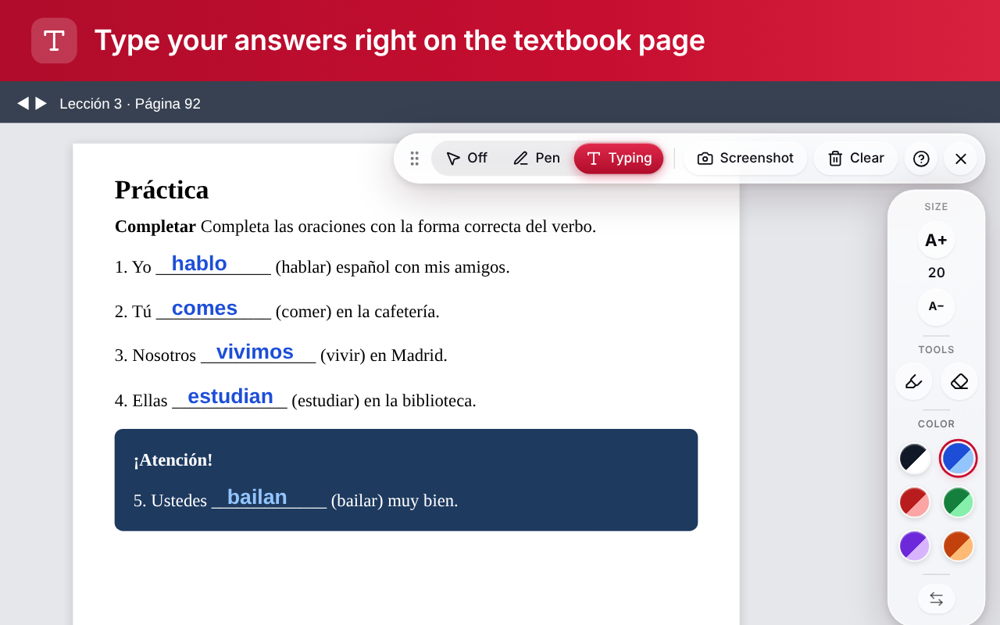
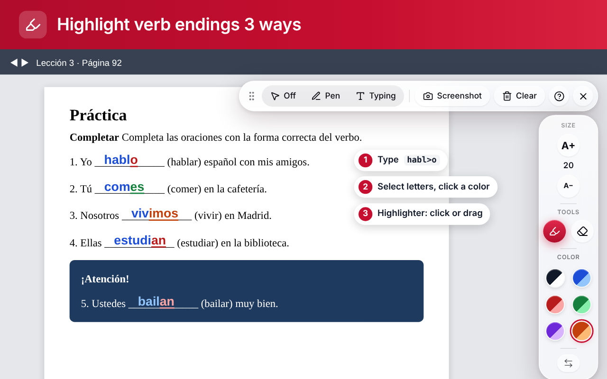
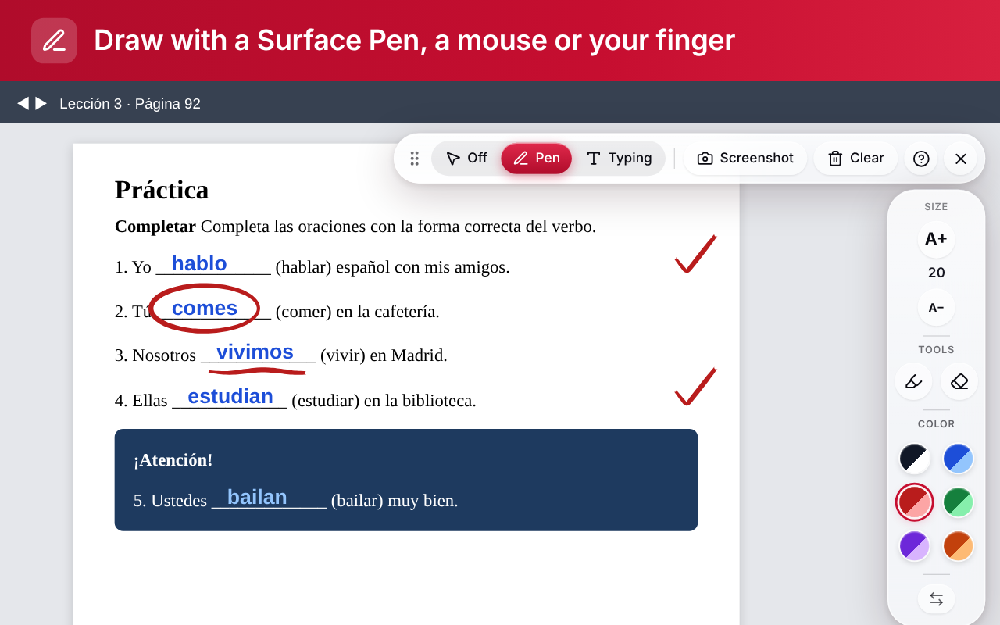
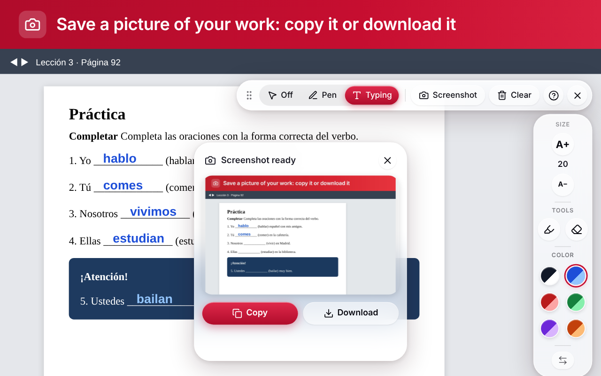
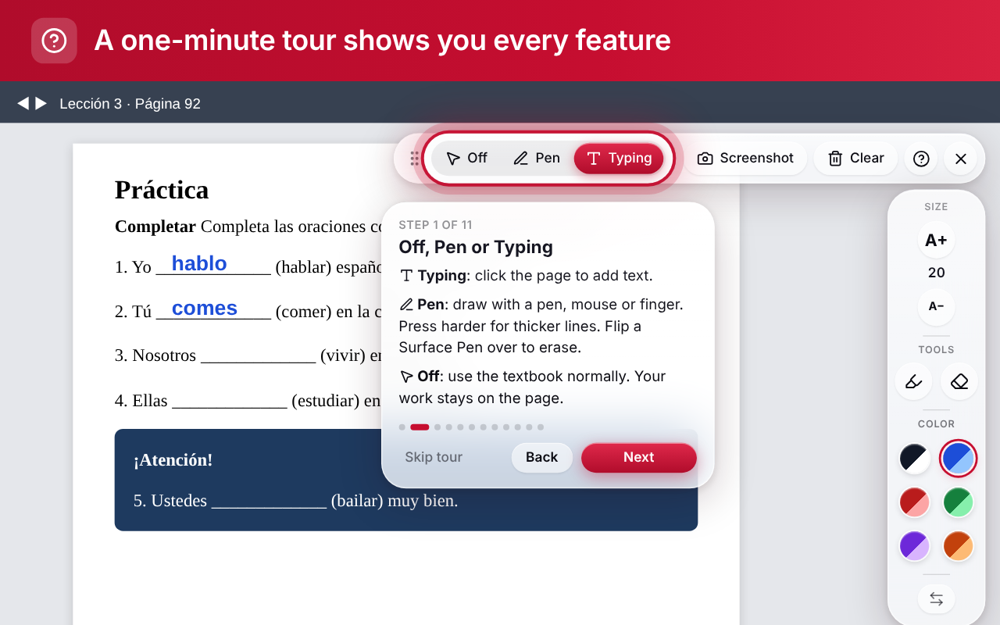
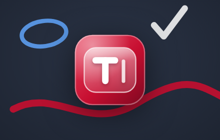

# Publishing VHL Text Overlay on the Chrome Web Store

Everything needed to publish, in the order the Chrome Web Store dashboard asks for it.
Text in the grey boxes is ready to copy and paste. All the images are in this folder.

**Time needed:** about 30 minutes to fill in, then Google's review (often a few days, sometimes
longer for a first submission).

---

## Checklist

- [ ] 1. Developer account set up (one-time $5 fee)
- [ ] 2. Release the new version and download `VHL-Text-Overlay.zip`
- [ ] 3. Upload the zip
- [ ] 4. **Store listing** tab: text, category, images
- [ ] 5. **Privacy** tab: purpose, permissions, data
- [ ] 6. **Distribution** tab: free, visibility, regions
- [ ] 7. **Test instructions** for the reviewer
- [ ] 8. Submit for review
- [ ] 9. After it's approved: update the README install steps

---

## 1. Developer account (one time)

1. Go to the [Chrome Web Store Developer Dashboard](https://chrome.google.com/webstore/devconsole)
   and sign in with the Google account that should own the extension.
2. Accept the developer agreement and pay the **one-time $5 registration fee**.
3. Under **Account**, verify your contact email and turn on 2-Step Verification for the
   Google account (the dashboard requires it to publish).
4. **Trader / non-trader:** the dashboard asks whether you publish as a business ("trader")
   under EU rules. A free hobby or class project is usually **non-trader**. Choose what
   honestly describes you.

## 2. Build the package

Publish the new features as a release first, so the store and GitHub have the same version:

- On GitHub: **Actions → Publish release → Run workflow → `minor`**. This makes **v0.3.0**
  (highlighter, pen mode, new icons).
- Download **`VHL-Text-Overlay.zip`** from the new release.

The zip already has `manifest.json` at its top level, which the store requires. Every later
upload needs a higher version number. The release workflow handles that.

## 3. Upload

Dashboard → **Items → New item** → choose `VHL-Text-Overlay.zip`.

The name, short summary and icons come from the zip:

| Field | Value (from `extension/manifest.json`) |
|---|---|
| Name | `VHL Text Overlay` |
| Summary (132 characters max) | `Type, highlight and draw on your VHL Central textbook pages, then copy or download a picture of your work.` |
| Icons | `extension/icons/icon16/32/48/128.png` (copies in [`icons/`](icons/)) |

## 4. Store listing tab

### Description

```
Do your VHL Central homework right on the textbook page, then save a picture of it.

VHL Text Overlay adds a small toolbar to the VHL Central textbook reader so you can fill in blanks, mark verb endings and draw, without printing anything.

TYPE
• Click any spot on the page and type. Click somewhere else to start another answer.
• Move or delete any answer with its small handles.
• Your text sticks to the page when you scroll or zoom.

HIGHLIGHT VERB ENDINGS
• Type ">" before the letters to mark them: habl>o gives hablo with the "o" marked.
• Or select letters and click a color, like in Word.
• Or use the highlighter: click or drag across letters.
• Marked letters are bold and underlined, so they show even in black-and-white printouts.

DRAW
• Pen mode: circle, underline or check off answers with a Surface Pen, a mouse or your finger.
• Press harder for thicker lines. Flip a Surface Pen over to erase.
• Ctrl+Z undoes, Ctrl+Shift+Z redoes.

ALWAYS READABLE
• The extension checks the colors behind your writing and picks a shade that stands out: light text on dark boxes, and a thin outline on photos.

SAVE YOUR WORK
• Screenshot takes a picture of the page with your writing (Chrome asks to share the tab; nothing is recorded or sent anywhere).
• Copy it to paste into an email, a Google Doc or an assignment, or Download it as a file.

EASY TO LEARN
• A one-minute tour shows every feature the first time. Skip it any time, replay it with the help button.
• In English and Spanish (follows your Chrome language).

PRIVATE
• Nothing you write or draw is saved or sent anywhere. It disappears when you reload the page, so take a screenshot first.
• Works only on vhlcentral.com pages.

Keyboard: Alt+Shift+T shows or hides the toolbars. Alt+Shift+S takes a screenshot.

—

EN ESPAÑOL: Escriba, resalte terminaciones verbales y dibuje sobre las páginas de su libro de VHL Central, y luego copie o descargue una imagen de su trabajo. Escriba ">" antes de las letras para marcarlas (habl>o). Funciona con un lápiz de Surface, el ratón o el dedo. Nada se guarda ni se envía.

VHL Text Overlay is an independent tool. It is not made by, endorsed by or affiliated with Vista Higher Learning.
```

### Category and language

| Field | Choose |
|---|---|
| Category | **Education** |
| Language | **English** |

### Images

Upload these from this folder. They were made from the real extension by
`npm run store-assets` (run it again after any UI change).

| Field | File | Size |
|---|---|---|
| Store icon (required) | [`store-icon-128.png`](store-icon-128.png) | 128×128 (96px artwork + 16px transparent padding, as Google asks) |
| Screenshot 1 | [`screenshot-1.png`](screenshot-1.png): typing answers | 1280×800 |
| Screenshot 2 | [`screenshot-2.png`](screenshot-2.png): all 3 ways to highlight verb endings (type `>`, select + color, highlighter) | 1280×800 |
| Screenshot 3 | [`screenshot-3.png`](screenshot-3.png): pen mode | 1280×800 |
| Screenshot 4 | [`screenshot-4.png`](screenshot-4.png): copy or download a picture | 1280×800 |
| Screenshot 5 | [`screenshot-5.png`](screenshot-5.png): the built-in tour | 1280×800 |
| Small promo tile | [`promo-small-440x280.png`](promo-small-440x280.png) | 440×280 |
| Marquee promo tile (optional) | [`promo-marquee-1400x560.png`](promo-marquee-1400x560.png) | 1400×560 |

The store allows **5 screenshots**, so each one shows a different main feature, in this
order. The first is the one most people see. Upload them in the numbered order.

The small promo tile is optional, but listings without one are shown after listings that
have one, so upload it. The promo tiles have no text, as Google recommends.

<table>
<tr><td></td><td></td><td></td></tr>
<tr><td></td><td></td><td></td></tr>
</table>

### Additional fields

| Field | Value |
|---|---|
| Homepage URL | `https://github.com/aidanmccants/vhl-overlay` |
| Support URL | `https://github.com/aidanmccants/vhl-overlay/issues` |
| Mature content | **Off** |
| YouTube video | Optional. Leave empty. |

## 5. Privacy tab

### Single purpose

```
Lets students and teachers type, highlight and draw temporary notes on top of VHL Central textbook pages, and save a picture of their work.
```

### Permission justifications

**activeTab**
```
After the user clicks the extension's toolbar button, the extension samples the colors behind the spot where the user starts writing (chrome.tabs.captureVisibleTab) to pick a text color that is readable. The image is analyzed in memory, only a brightness value is kept, and the image is discarded immediately. Nothing is stored or sent.
```

**storage**
```
Remembers the toolbar settings for the open tab (mode, color, text size, toolbar side) in session storage, cleared when the tab closes, and one yes/no setting for whether the first-run tour has been shown. No personal data is stored.
```

**clipboardWrite**
```
Puts the screenshot the user just took on the clipboard when they click "Copy", so they can paste it into an email, document or assignment.
```

**Host permission (*://*.vhlcentral.com/*)**
```
The extension's only purpose is writing on VHL Central textbook pages, so its toolbar and overlay run on vhlcentral.com pages only, including the frames of the textbook reader. It does not run on any other site.
```

### Remote code

Choose **No, I am not using remote code.** (Everything, including the Lucide icons, is in
the package.)

### Data usage

- Leave **every data type unchecked**: the extension collects none of them.
- Check all three certifications:
  - I do not sell or transfer user data to third parties, outside of the approved use cases.
  - I do not use or transfer user data for purposes that are unrelated to my item's single purpose.
  - I do not use or transfer user data to determine creditworthiness or for lending purposes.

### Privacy policy URL

```
https://github.com/aidanmccants/vhl-overlay/blob/main/docs/PRIVACY.md
```

(The policy is [`docs/PRIVACY.md`](../PRIVACY.md). This link works once this branch is
merged into `main`.)

## 6. Distribution tab

| Field | Choose |
|---|---|
| Payment | **Free** |
| Visibility | **Public** (anyone can find it), or **Unlisted** (only people with the link, e.g. one class) |
| Regions | **All regions** |

## 7. Test instructions (for Google's reviewer)

The VHL textbook needs a school login, which the reviewer won't have. The extension also
runs on VHL Central's public pages, so the reviewer can test every feature there:

```
No account is needed. The extension runs on every vhlcentral.com page, including the public home and login pages.

1. Open https://www.vhlcentral.com/
2. Click the extension's toolbar button (red "T" icon), or press Alt+Shift+T. A top bar and a side toolbar appear; a short skippable tour starts the first time.
3. Typing: click anywhere on the page and type. Type habl>o to see the "o" highlighted.
4. Pen: click "Pen" on the top bar and draw with the mouse. Ctrl+Z undoes.
5. Screenshot: click "Screenshot" and choose this tab when Chrome asks to share it. Then click Copy or Download.
6. "Off" returns the page to normal. The X button hides the toolbars.

The extension stores nothing, collects nothing and makes no network requests.
```

## 8. Submit

Click **Submit for review**. You'll get an email when it's approved or if the reviewer has
questions. While it's in review you can't change the listing. Cancel the review if you need to.

## 9. After it's approved

- Copy the store link (`https://chromewebstore.google.com/detail/...`).
- Update the README's install steps to "**Add to Chrome**" from the store link. That replaces
  Developer mode and Load unpacked, and Chrome then updates the extension automatically.
- For each new version: run the release workflow, then in the dashboard choose
  **Package → Upload new package** with the new zip and submit again.

---

### Requirements this follows

From Google's [image guidelines](https://developer.chrome.com/docs/webstore/images),
[listing page](https://developer.chrome.com/docs/webstore/cws-dashboard-listing),
[privacy tab](https://developer.chrome.com/docs/webstore/cws-dashboard-privacy) and the
[manifest `description` limit](https://developer.chrome.com/docs/extensions/reference/manifest/description)
(132 characters).
